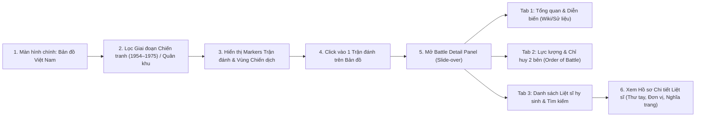
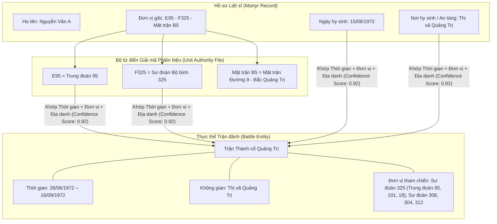

# PRD: Bản Đồ Số Các Trận Đánh & Tra Cứu Liệt Sĩ Chiến Tranh Việt Nam (1954–1975)
**Dự án:** Ký Ức Việt Nam — Nhánh B: *Vietnam Memory Platform* (Kết hợp Demo 2 *"Một người – Nhiều kho"* & Demo 3 *"Bản đồ ký ức"*)
**Phiên bản:** 1.0
**Ngày cập nhật:** 06/11/2026

> [!IMPORTANT]
> **Tầm nhìn sản phẩm:** Xây dựng một bản đồ lịch sử tương tác lấy **Bản đồ Việt Nam** làm trung tâm, cho phép người dùng lọc theo từng **giai đoạn chiến lược của cuộc kháng chiến (1954–1975)**, khám phá chi tiết từng **trận đánh/chiến dịch** (bối cảnh, diễn biến, lực lượng & chỉ huy hai bên), và đặc biệt là **tra cứu danh sách các Anh hùng Liệt sĩ đã ngã xuống trong từng trận đánh** thông qua liên kết tri thức (*Knowledge Graph*) từ Wikipedia Tiếng Việt, cổng dữ liệu chính thống và hồ sơ cựu chiến binh/gia đình.

---

## 1. Tổng Quan & Mục Tiêu Sản Phẩm (Product Overview & Goals)

### 1.1. Bối cảnh & Vấn đề cần giải quyết
Trong khuôn khổ dự án **Ký Ức Việt Nam** (`Brief_Brainstorm_Ky_Uc_Viet_Nam_v1_2 (1).pdf` và `Kien_truc_giai_phap_Cloud_Ky_Uc_Viet_Nam.pdf`):
1. **Dữ liệu lịch sử và hồ sơ liệt sĩ bị phân tán:** Thông tin trận đánh nằm rải rác trên Wikipedia Tiếng Việt, sách lịch sử sư đoàn/quân đoàn, báo chí; trong khi dữ liệu liệt sĩ nằm ở các cổng tra cứu mộ chí (`thongtinlietsi.gov.vn`, `chinhsachquandoi.gov.vn`, `trianlietsi.vn`, `nhantimdongdoi.org`) và giấy báo tử gia đình.
2. **Khoảng trống liên kết giữa "Trận đánh" và "Liệt sĩ":** Giấy báo tử thời chiến thường chỉ ghi **phiên hiệu/mật danh đơn vị** (ví dụ: *Đơn vị KB, Mặt trận B3, K4, F325, E95...*) và **ngày hy sinh**, không ghi tên trận đánh như trong sách sử. Người dân, thân nhân liệt sĩ và thế hệ trẻ khi đọc về một trận đánh chưa thể nhìn thấy ngay những ai đã ngã xuống tại đó, hoặc từ một liệt sĩ chưa hình dung được trận đánh ác liệt nơi người lính đã hy sinh.
3. **Thiếu trực quan hóa không gian – thời gian:** Người học lịch sử và công chúng cần một giao diện khởi đầu trực quan bằng **Bản đồ Việt Nam** kèm bộ lọc dòng thời gian thay vì các trang văn bản rời rạc.

### 1.2. Đối tượng người dùng mục tiêu (Target Personas)
| Nhóm người dùng | Nhu cầu cốt lõi | Hành vi chính trên hệ thống |
| :--- | :--- | :--- |
| **1. Gia đình & Thân nhân Liệt sĩ** | Tìm hiểu trận đánh nơi người thân hy sinh; tìm đồng đội cùng đơn vị/trận đánh; bổ sung di vật, thư tay, ảnh liệt sĩ. | Tìm tên liệt sĩ hoặc chọn trận đánh/chiến trường → Xem danh sách liệt sĩ theo đơn vị/ngày hy sinh → Đóng góp tư liệu (*"Chuyện nhà tôi"*). |
| **2. Học sinh, Sinh viên & Công chúng** | Học và trải nghiệm lịch sử trực quan theo bản đồ và giai đoạn; hiểu quy mô, lực lượng 2 bên và sự hy sinh của thế hệ trước. | Lọc giai đoạn (1954–1975) trên bản đồ → Click vào điểm nóng trận đánh → Đọc tóm tắt diễn biến, tương quan lực lượng và câu chuyện liệt sĩ tiêu biểu. |
| **3. Cựu chiến binh & Cộng tác viên (CTV)** | Đối chiếu phiên hiệu đơn vị, xác minh danh sách đồng đội hy sinh tại các cao điểm/chiến dịch cụ thể. | Duyệt trận đánh theo Sư đoàn/Trung đoàn → Rà soát danh sách liệt sĩ → Đề xuất hiệu đính/xác minh (từ mức `L2` lên `L3`/`L4`). |
| **4. Nhà nghiên cứu sử học & Bảo tàng** | Tra cứu chéo đa nguồn (Wikipedia, sử đơn vị, tư liệu quốc tế), phân tích dữ liệu không gian - thời gian. | Khai thác Knowledge Graph (`Người – Đơn vị – Trận đánh – Địa danh – Tư liệu`) kèm nguồn trích dẫn minh bạch. |

---

## 2. Luồng Trải Nghiệm Người Dùng (Core User Journey)



---

## 3. Yêu Cầu Chức Năng Chi Tiết (Functional Requirements)

### 3.1. Module 1: Bản Đồ Lịch Sử Việt Nam Tương Tác (Interactive Vietnam Map)
* **FR-MAP-01 (Khởi đầu bằng Bản đồ Việt Nam):**
  * Giao diện mặc định khi vào trang chủ là bản đồ Việt Nam toàn màn hình (2D/3D địa hình hỗ trợ Mapbox GL / MapLibre), thể hiện đầy đủ lãnh thổ đất liền, **Vĩ tuyến 17 (Khu phi quân sự DMZ - Sông Bến Hải - Cầu Hiền Lương)**, hệ thống **Đường Trường Sơn (Đường Hồ Chí Minh)**, và đầy đủ hai quần đảo **Hoàng Sa, Trường Sa**.
* **FR-MAP-02 (Lớp bản đồ lịch sử - Historical Map Layers):**
  * Cho phép bật/tắt ranh giới hành chính thời chiến (Quân khu / Mặt trận B1, B2, B3 Tây Nguyên, B4 Trị-Thiên, B5 Đường 9...) so với ranh giới tỉnh/thành phố hiện nay (địa danh xưa – nay).
* **FR-MAP-03 (Hiển thị Điểm Trận Đánh & Vùng Chiến Dịch):**
  * **Marker Trận đánh (Battle Pin):** Phân biệt bằng icon/màu sắc theo loại hình (Trận đánh bộ binh, Phòng không - Không quân, Hải chiến/Đường sông, Đặc công/Biệt động) và quy mô (Cấp Tiểu đoàn, Trung đoàn, Sư đoàn, Chiến dịch cấp Quân đoàn/Mặt trận).
  * **Polygon/Arrows Chiến dịch:** Khi zoom vào một chiến dịch lớn (ví dụ: *Chiến dịch Tây Nguyên 1975* hoặc *Chiến dịch Hồ Chí Minh*), hiển thị mũi tên hướng tiến công và phạm vi chiến trường.

### 3.2. Module 2: Bộ Lọc Giai Đoạn Chiến Tranh & Đa Tiêu Chí (Period & Facet Filtering)
Thanh điều khiển phía trên/dưới bản đồ cho phép lọc nhanh theo **5 Giai đoạn lịch sử chuẩn** của cuộc Kháng chiến chống Mỹ, cứu nước (1954–1975):

| Mã giai đoạn | Tên giai đoạn lịch sử | Năm | Đặc trưng chiến lược & Trận đánh tiêu biểu trên Bản đồ |
| :--- | :--- | :--- | :--- |
| **P1** | **Giữ gìn lực lượng & Đồng Khởi** | `1954 – 1960` | Đấu tranh chính trị kết hợp vũ trang tự vệ, tiến lên Phong trào Đồng Khởi. *Tiêu biểu: Đồng Khởi Bến Tre (Mỏ Cày), Tua Hai (Tây Ninh), Trà Bồng (Quảng Ngãi).* |
| **P2** | **Chiến tranh Đặc biệt** | `1961 – 1965` | Đối đầu chiến thuật "Trực thăng vận", "Thiết xa vận" và hệ thống "Ấp chiến lược" của QLVNCH + cố vấn Mỹ. *Tiêu biểu: Trận Ấp Bắc (1963), Bình Giã (1964), An Lão (1964), Ba Gia (1965), Đồng Xoài (1965).* |
| **P3** | **Chiến tranh Cục bộ & Phá hoại miền Bắc lần 1** | `1965 – 1968` | Quân viễn chinh Mỹ & đồng minh trực tiếp tham chiến ("Tìm và Diệt"); Không quân/Hải quân Mỹ đánh phá miền Bắc (*Sấm Rền*). *Tiêu biểu: Trận Vạn Tường (1965), Pleime – Ia Đrăng (1965), Củ Chi, Đắk Tô (1967), Đường 9 – Khe Sanh (1968), Tổng tiến công và nổi dậy Tết Mậu Thân (1968).* |
| **P4** | **Việt Nam hóa Chiến tranh & Phá hoại miền Bắc lần 2** | `1969 – 1973` | Quân Mỹ rút dần, QLVNCH nhận trang bị tối đa kèm hỏa lực Mỹ yểm trợ; Đỉnh cao đối đầu năm 1972 dẫn tới Hiệp định Paris. *Tiêu biểu: Đồi Thịt Băm / A Bia (1969), Đường 9 – Nam Lào (1971), Chiến dịch Xuân – Hè 1972 (Đắk Tô - Tân Cảnh, Lộc Ninh), 81 ngày đêm Thành cổ Quảng Trị (1972), Điện Biên Phủ trên không / Linebacker II (12/1972).* |
| **P5** | **Tổng tiến công và Nổi dậy mùa Xuân 1975** | `1973 – 1975` | Đánh bại các cuộc hành quân "tràn ngập lãnh thổ" sau Hiệp định Paris, tạo thế và lực giải phóng hoàn toàn miền Nam. *Tiêu biểu: Thượng Đức (1974), Chiến dịch Đường 14 – Phước Long (1/1975), Chiến dịch Tây Nguyên (Buôn Ma Thuột, 3/1975), Chiến dịch Huế – Đà Nẵng (3/1975), Chiến dịch Xuân Lộc (4/1975), Chiến dịch Hồ Chí Minh (26–30/4/1975).* |

* **Các bộ lọc bổ sung (Secondary Filters):**
  * **Tìm kiếm nhanh trên bản đồ:** Nhập tên trận đánh, tên địa danh (xưa/nay), phiên hiệu đơn vị (VD: *Sư đoàn 325*, *Trung đoàn 66*, *Tiểu đoàn 261*), hoặc **Họ tên Liệt sĩ** (bản đồ sẽ tự động highlight các trận đánh/mặt trận mà liệt sĩ hoặc đơn vị của liệt sĩ đó tham gia).
  * **Lọc theo Mặt trận / Khu vực:** Miền Bắc, Trị - Thiên, Tây Nguyên (B3), Duyên hải Miền Trung (Khu 5), Đông Nam Bộ (B2), Tây Nam Bộ (Khu 8, Khu 9).

---

### 3.3. Module 3: Bảng Thông Tin Chi Tiết Trận Đánh (Battle Detail Panel)
Khi người dùng **click vào một điểm trận đánh (Marker)** trên bản đồ, một bảng trượt (**Slide-over Panel** chiếm 45–50% chiều rộng màn hình bên phải, có thể mở rộng toàn màn hình) sẽ xuất hiện mà không làm mất ngữ cảnh bản đồ bên trái.

Bảng gồm **4 khu vực (Tabs)** chính:

#### Tab 1: Tổng Quan & Diễn Biến (Overview & Timeline)
* **Header:**
  * Tên trận đánh / chiến dịch chính thức (kèm tên gọi phía đối phương nếu có, ví dụ: *Chiến dịch Đường 9 - Nam Lào / Hành quân Lam Sơn 719*).
  * Thời gian bắt đầu – kết thúc; Địa danh lịch sử & Địa danh hành chính hiện nay; Tọa độ GPS.
  * Nhãn Giai đoạn (VD: `1969–1973 · Việt Nam hóa chiến tranh`) & Cấp độ xác minh dữ liệu (`L1`–`L4`).
* **Mô tả & Bối cảnh chiến lược:** Tóm tắt chuẩn xác bối cảnh dẫn đến trận đánh.
* **Diễn biến theo mốc thời gian (Interactive Mini-Timeline):** Chia theo từng đợt/ngày của trận đánh (khi bấm vào từng đợt, bản đồ bên trái zoom vào các cao điểm/tọa độ tương ứng).
* **Kết quả & Ý nghĩa lịch sử:** Tác động quân sự, chính trị, ngoại giao của trận đánh.

#### Tab 2: Lực Lượng Tham Chiến Hai Bên (Combatants / Order of Battle)
Hiển thị bảng đối sánh trực quan (Side-by-Side Comparison) giữa hai bên tham chiến:

| Trường thông tin | Bên A: Lực lượng Cách mạng (QĐNDVN / QGPMNVN) | Bên B: Hoa Kỳ, QLVNCH & Đồng minh |
| :--- | :--- | :--- |
| **Lực lượng / Cờ hiệu** | Quân đội Nhân dân Việt Nam (QĐNDVN), Quân Giải phóng miền Nam Việt Nam (Mặt trận Dân tộc Giải phóng MNVN) | Quân đội Hoa Kỳ, Quân lực Việt Nam Cộng hòa (QLVNCH), Quân đội Đồng minh (Hàn Quốc, Úc, Thái Lan, New Zealand) |
| **Chỉ huy & Lãnh đạo** | Tư lệnh Mặt trận, Chính ủy, Sư đoàn trưởng, Trung đoàn trưởng (kèm link hồ sơ nhân vật) | Tư lệnh chiến trường, Cố vấn trưởng, Chỉ huy Sư đoàn/Lữ đoàn |
| **Đơn vị tham chiến (Phiên hiệu)** | Liệt kê chi tiết Quân đoàn, Sư đoàn (`F`), Trung đoàn (`E`), Tiểu đoàn (`K`/`D`), Đặc công, Du kích địa phương | Liệt kê Sư đoàn (VD: Kỵ binh bay số 1, TQLC, Sư đoàn Dù...), Lữ đoàn, Tiểu đoàn, Phi đoàn |
| **Quân số & Vũ khí** | Quân số ước tính, trang bị hỏa lực (pháo binh, tên lửa SAM-2, MiG-21, xe tăng T-54...) | Quân số, pháo hạm, xe bọc thép M113, M48, trực thăng UH-1, máy bay B-52... |
| **Thương vong & Tổn thất** | Số liệu hy sinh, bị thương (ghi rõ nguồn công bố của Việt Nam và nguồn đối chiếu quốc tế theo nguyên tắc *Provenance-first*) | Số liệu tử trận, bị thương, bị bắt, phương tiện bị bắn rơi/phá hủy (ghi rõ theo nguồn Việt Nam và nguồn Mỹ/QLVNCH) |

#### Tab 3: Danh Sách Liệt Sĩ Hy Sinh Trong Trận Đánh (Martyrs Roll of Honor & Search)
Đây là tính năng trọng tâm mang giá trị nhân văn của **Ký Ức Việt Nam**:
* **Thống kê đầu bảng:**
  * Tổng số chiến sĩ ước tính hy sinh trong trận đánh/chiến dịch.
  * Số lượng hồ sơ Liệt sĩ đã được định danh và liên kết trên hệ thống (phân theo mức xác minh: `L4 - Đã chứng thực cơ quan/bảo tàng`, `L3 - CTV/Cựu chiến binh đối chiếu`, `L2 - Khớp tự động theo Phiên hiệu đơn vị + Ngày hy sinh`).
* **Góc Tưởng Niệm Liệt Sĩ Tiêu Biểu / Anh Hùng LLVTND:**
  * Thẻ nổi bật (Featured Cards) giới thiệu các Anh hùng, Liệt sĩ tiêu biểu của trận đánh kèm ảnh chân dung, câu chuyện hy sinh, và di vật/thư tay (ví dụ: *3 chiến sĩ gang thép* tại Ấp Bắc; Liệt sĩ *Lê Văn Huỳnh* cùng bức thư di bút tại Thành cổ Quảng Trị; Phi công *Vũ Xuân Thiều* trong Điện Biên Phủ trên không...).
* **Bảng Tra Cứu & Lọc Danh Sách Liệt Sĩ (Searchable Martyrs Table):**
  * **Thanh tìm kiếm & Bộ lọc tại chỗ:**
    * Tìm theo **Họ và tên liệt sĩ** (hỗ trợ tìm kiếm không dấu, tên gọi khác/bí danh).
    * Lọc theo **Quê quán / Nguyên quán** (Tỉnh/Thành phố, Huyện, Xã — hỗ trợ cả địa danh hành chính cũ trước sáp nhập và địa danh mới).
    * Lọc theo **Đơn vị / Phiên hiệu** (VD: *Sư đoàn 325*, *Trung đoàn 66*, *Tiểu đoàn 261*).
    * Lọc theo **Năm sinh** hoặc **Ngày/Tháng hy sinh** trong phạm vi trận đánh.
    * Lọc theo **Nghĩa trang Liệt sĩ an táng** (VD: *NTLS Quốc gia Trường Sơn*, *NTLS Đường 9*, *NTLS Thành cổ Quảng Trị*, hoặc *Chưa xác định được phần mộ*).
  * **Các cột hiển thị trong danh sách:**
    1. Họ và tên Liệt sĩ (kèm Bí danh)
    2. Năm sinh – Ngày hy sinh
    3. Quê quán
    4. Cấp bậc, Chức vụ & Đơn vị (Phiên hiệu gốc trên Giấy báo tử + Đơn vị giải mã)
    5. Nơi an táng hiện nay (Tọa độ mộ/Khu/Lô/Hàng nếu có)
    6. Cấp độ xác minh (`L1`–`L4`) & Nguồn trích dẫn
  * **Click vào 1 Liệt sĩ:** Mở Modal/Trang **Hồ sơ Người lính (Soldier Profile)** hiển thị: Bằng Tổ quốc ghi công, ảnh chân dung, thư tay/nhật ký đã phiên âm AI (tích hợp *Demo 1 - Lá thư trở về*), vị trí mộ phần, lời kể đồng đội, và nút **"Gia đình / Đồng đội bổ sung thông tin"**.

#### Tab 4: Tư Liệu & Nguồn Đối Chiếu (Wikipedia Tiếng Việt & Nguồn Chính Thống)
* Hiển thị đoạn trích chuẩn kèm liên kết gốc tới bài viết trên **Wikipedia Tiếng Việt** (`vi.wikipedia.org`).
* Liên kết các bài viết chuyên sâu từ **Báo Quân đội Nhân dân** (`qdnd.vn`), **Cổng TTĐT Bộ Quốc phòng** (`mod.gov.vn`), Bảo tàng Lịch sử Quân sự Việt Nam, và kho ảnh/video tư liệu (IIIF Image Viewer).

---

## 4. Chiến Lược Dữ Liệu & Giải Pháp Kỹ Thuật Tìm Kiếm Liệt Sĩ Theo Trận Đánh

> [!TIP]
> **Bài toán nghiệp vụ quan trọng nhất:** Làm sao lập được danh sách Liệt sĩ cho từng trận đánh khi phần lớn cơ sở dữ liệu mộ liệt sĩ chỉ có *Họ tên, Quê quán, Ngày hy sinh, Phiên hiệu đơn vị (mật danh)* và *Nơi hy sinh/Nghĩa trang*?

### 4.1. Hệ Sinh Thái Nguồn Dữ Liệu (Data Sources)
Hệ thống kết nối theo mô hình **Federated + Harvest có phép** (tuân thủ kiến trúc `Kien_truc_giai_phap_Cloud_Ky_Uc_Viet_Nam.pdf`):

1. **Nguồn dữ liệu Trận đánh & Lịch sử quân sự:**
   * **Wikipedia Tiếng Việt MediaWiki API (`vi.wikipedia.org/w/api.php`):** Thu thập tự động các bài viết thuộc *Thể loại:Trận đánh và chiến dịch trong Chiến tranh Việt Nam*, bóc tách Infobox (`Bản mẫu:Thông tin trận đánh` gồm thời gian, địa điểm, kết quả, tham chiến, chỉ huy, lực lượng, thương vong) và nội dung diễn biến.
   * **Sử biên niên các Sư đoàn/Quân đoàn & Báo chí chính thống:** Báo Quân đội Nhân dân (`qdnd.vn`), Cổng TTĐT Bộ Quốc phòng (`mod.gov.vn`), Lịch sử Sư đoàn 304, 308, 312, 320, 324, 325, 341, Sư đoàn 5, 7, 9...
2. **Nguồn dữ liệu Liệt sĩ & Mộ liệt sĩ:**
   * **Cổng thông tin điện tử về Liệt sĩ, Mộ liệt sĩ và Nghĩa trang liệt sĩ (`thongtinlietsi.gov.vn`)** & **Cổng TTĐT Ngành Chính sách Quân đội (`chinhsachquandoi.gov.vn`)**: Dữ liệu hơn 3.000 nghĩa trang liệt sĩ toàn quốc.
   * **Hội Hỗ trợ gia đình liệt sĩ Việt Nam (`trianlietsi.vn`)** & **Trung tâm MARIN (`nhantimdongdoi.org`)**: Các danh sách liệt sĩ hy sinh theo từng mặt trận, cao điểm, chiến dịch và danh sách trích lục của Ban liên lạc Cựu chiến binh các sư đoàn.
   * **Đóng góp trực tiếp từ Gia đình & Ban liên lạc Cựu chiến binh (Crowdsourcing có kiểm duyệt):** Giấy báo tử, sổ vàng truyền thống của các đơn vị, bia tưởng niệm tại các di tích trận đánh (như Thành cổ Quảng Trị, Bến vượt sông Thạch Hãn, Đồi A1/Khe Sanh, Địa đạo Củ Chi...).

### 4.2. Thuật Toán Ánh Xạ "Liệt Sĩ ↔ Trận Đánh" (Entity Resolution & Knowledge Graph)
Để gắn kết chính xác một hồ sơ liệt sĩ vào một trận đánh cụ thể, hệ thống sử dụng **Bộ giải mã Phiên hiệu – Không gian – Thời gian** trên Knowledge Graph:



* **Quy tắc tính điểm tin cậy (Confidence Scoring & Verification Levels `L0` → `L4`):**
  * **Mức `L4` (Chứng thực chính thức):** Liệt sĩ có tên trong Sổ vàng truyền thống của trận đánh, Danh sách khắc bia tại Khu tưởng niệm trận đánh, hoặc văn bản xác nhận của cơ quan chính sách/bảo tàng.
  * **Mức `L3` (Cộng đồng/Cựu chiến binh đối chiếu):** Ban liên lạc cựu chiến binh đơn vị hoặc CTV xác nhận dựa trên hồ sơ đơn vị và giấy báo tử.
  * **Mức `L2` (AI gợi ý liên kết - Cần hiển thị rõ nhãn "Gợi ý theo phiên hiệu & thời gian"):** Hồ sơ liệt sĩ có `Ngày hy sinh` nằm trong khoảng `[Start_Date, End_Date]` của trận đánh **VÀ** (`Đơn vị/Phiên hiệu` thuộc danh sách đơn vị tham chiến của trận đánh **HOẶC** `Nơi hy sinh` trùng với địa danh trận đánh).

---

## 5. Bộ Dữ Liệu Mẫu Thực Tế (Seed Data Catalog) Từ Wikipedia Tiếng Việt & Nguồn Chính Thống

Dưới đây là **6 trận đánh/chiến dịch mẫu đại diện cho các giai đoạn**, đã được trích xuất thông tin thực tế từ Wikipedia Tiếng Việt và các nguồn sử liệu để dùng ngay cho bản dựng MVP (Prototype / Demo):

### 5.1. Trận Ấp Bắc (02/01/1963) — *Giai đoạn Chiến tranh Đặc biệt (1961–1965)*
* **Tọa độ & Địa điểm:** Ấp Bắc, xã Tân Phú, huyện Cai Lậy, tỉnh Mỹ Tho (nay là thị xã Cai Lậy, tỉnh Tiền Giang) — `10.4358° N, 106.1422° E`.
* **Mô tả (Wikipedia TV):** Trận đánh quy mô cấp tiểu đoàn đánh dấu bước ngoặt làm phá sản chiến thuật *"Trực thăng vận"* và *"Thiết xa vận"* của Mỹ - QLVNCH.
* **Lực lượng tham chiến hai bên:**
  * **Quân Giải phóng MNVN:** ~350 quân (Đại đội 1 Tiểu đoàn 261 Khu 8, Đại đội 1 Tiểu đoàn 514 tỉnh Mỹ Tho, ~30 du kích xã Tân Phú). **Chỉ huy:** Tiểu đoàn trưởng Hai Hoàng (Võ Văn Điều), Đặng Minh Nhuận (Bảy Đen).
  * **QLVNCH & Hoa Kỳ:** ~1.400–1.800 quân (3 tiểu đoàn thuộc Trung đoàn 11 Sư đoàn 7 Bộ binh QLVNCH, 2 đại đội Bảo an, Tiểu đoàn 8 Nhảy dù, Chi đoàn 4 Thiết giáp với 13 xe M113, ~30 máy bay gồm 15 trực thăng H-21/UH-1, 13 tàu chiến). **Chỉ huy:** Đại tá Bùi Đình Đạm, Thiếu tướng Huỳnh Văn Cao, Cố vấn trưởng Mỹ Trung tá John Paul Vann.
* **Thương vong:**
  * **Quân Giải phóng:** 18 chiến sĩ hy sinh, 39 bị thương.
  * **QLVNCH & Hoa Kỳ:** QLVNCH: 83 chết, >100 bị thương; Mỹ: 3 cố vấn/phi công chết, 8 bị thương; 5 trực thăng bị bắn rơi, 3 xe bọc thép M113 bị bắn cháy.
* **Liệt sĩ tiêu biểu (Đã xác minh `L4`):**
  * Cụm **"Ba chiến sĩ gang thép Ấp Bắc"** (hy sinh anh dũng tại công sự sau khi chặn đứng đợt tấn công của xe M113, được truy tặng Anh hùng LLVTND):
    1. Liệt sĩ **Nguyễn Văn Đừng** (tức Nguyễn Văn Còng, bí danh Công) — Tiểu đội trưởng.
    2. Liệt sĩ **Đỗ Văn Trạch** (bí danh Hùng).
    3. Liệt sĩ **Lê Văn Toản** (bí danh Hoàng).

### 5.2. Trận Ia Đrăng – Pleime (14/11 – 18/11/1965) — *Giai đoạn Chiến tranh Cục bộ (1965–1968)*
* **Tọa độ & Địa điểm:** Thung lũng Ia Đrăng, chân núi Chư Prông, huyện Chư Prông, tỉnh Gia Lai — `13.5917° N, 107.7128° E`.
* **Mô tả (Wikipedia TV):** Trận đụng độ lớn đầu tiên giữa chủ lực Quân đội Nhân dân Việt Nam (Mặt trận B3 Tây Nguyên) và Sư đoàn Kỵ binh bay số 1 của Quân đội Hoa Kỳ tại bãi đáp X-Ray (LZ X-Ray) và Albany (LZ Albany).
* **Lực lượng tham chiến hai bên:**
  * **QĐNDVN / Quân Giải phóng (Mặt trận B3):** Trung đoàn 66 (Tiểu đoàn 7, 8, 9), Tiểu đoàn 1 Trung đoàn 33. **Chỉ huy:** Thiếu tướng Chu Huy Mân (Tư lệnh kiêm Chính ủy Mặt trận B3), Thượng tá Nguyễn Hữu An (Tham mưu phó Mặt trận, chỉ huy tiền phương), Trung đoàn trưởng Trung đoàn 66 La Ngọc Châu, Chính ủy Đặng Vũ Hiệp.
  * **Quân đội Hoa Kỳ:** Lữ đoàn 3, Sư đoàn Kỵ binh số 1 (Không kỵ) gồm Tiểu đoàn 1/7, 2/7 và 2/5, được yểm trợ bởi pháo đài bay B-52 và pháo binh. **Chỉ huy:** Thiếu tướng Harry Kinnard, Trung tá Harold G. Moore (Tiểu đoàn 1/7), Trung tá Robert McDade (Tiểu đoàn 2/7).
* **Thương vong:**
  * **QĐNDVN:** Theo tổng kết phía Việt Nam tại khu vực bãi đáp: 208 chiến sĩ hy sinh, 146 bị thương (tổng cả chiến dịch Pleime là 554 hy sinh).
  * **Hoa Kỳ:** 234–305 lính Mỹ tử trận (riêng tại LZ X-Ray và LZ Albany), >524 bị thương.
* **Phiên hiệu tra cứu Liệt sĩ:** `Trung đoàn 66 (Đoàn Pleime)`, `Trung đoàn 33`, `Mặt trận B3 Tây Nguyên`, thời gian `10/1965 – 11/1965` (Nghĩa trang Liệt sĩ huyện Chư Prông & NTLS tỉnh Gia Lai).

### 5.3. Chiến dịch Đường 9 – Khe Sanh (20/01 – 15/07/1968) — *Giai đoạn Chiến tranh Cục bộ (1965–1968)*
* **Tọa độ & Địa điểm:** Huyện Hướng Hóa, tỉnh Quảng Trị (Làng Vây, Tà Cơn, Đồi Động Tri, Đường 9) — `16.6542° N, 106.7242° E`.
* **Lực lượng tham chiến hai bên:**
  * **QĐNDVN (Bộ Tư lệnh Mặt trận Đường 9 - B5):** Sư đoàn 304, Sư đoàn 325C, Sư đoàn 320, Trung đoàn 270, Tiểu đoàn xe tăng 198 (trận đầu tiên bộ đội Tăng - Thiết giáp xuất trận với xe PT-76 tại Làng Vây). **Chỉ huy:** Thiếu tướng Trần Quý Hai (Tư lệnh), Thiếu tướng Lê Quang Đạo (Chính ủy).
  * **Hoa Kỳ & QLVNCH:** Trung đoàn 26 Thủy quân lục chiến Mỹ, Tiểu đoàn 37 Biệt động quân QLVNCH, Lực lượng Biệt kích Làng Vây. **Chỉ huy:** Đại tướng William Westmoreland, Đại tá David E. Lownds.
* **Liệt sĩ tiêu biểu & Phiên hiệu tra cứu:**
  * Liệt sĩ - Anh hùng LLVTND **Bùi Ngọc Đủ** cùng các liệt sĩ thuộc `Sư đoàn 304`, `Sư đoàn 325C`, `Đoàn 559` (an táng chủ yếu tại **Nghĩa trang Liệt sĩ Quốc gia Đường 9** và NTLS huyện Hướng Hóa).

### 5.4. Trận Thành Cổ Quảng Trị — 81 Ngày Đêm (28/06 – 16/09/1972) — *Giai đoạn Việt Nam hóa Chiến tranh (1969–1973)*
* **Tọa độ & Địa điểm:** Thành cổ Quảng Trị và đôi bờ sông Thạch Hãn, thị xã Quảng Trị, tỉnh Quảng Trị — `16.7506° N, 107.1872° E`.
* **Mô tả (Wikipedia TV):** Cuộc chiến đấu phòng ngự 81 ngày đêm ác liệt trong Chiến dịch Xuân – Hè 1972 dưới sức hủy diệt của hơn 328.000 tấn bom đạn (tương đương sức công phá của 7 quả bom nguyên tử ném xuống Hiroshima), phục vụ trực tiếp đấu tranh ngoại giao tại Hội nghị Paris.
* **Lực lượng tham chiến hai bên:**
  * **QĐNDVN (Mặt trận B5 Quảng Trị):** Sư đoàn 325 (Trung đoàn 95, 18, 101), Sư đoàn 308, Sư đoàn 304, Sư đoàn 312, Trung đoàn 48 (Sư đoàn 320B - Đoàn Quang Sơn), Tiểu đoàn 3 và Tiểu đoàn 8 bộ đội địa phương Quảng Trị. **Chỉ huy:** Thiếu tướng Trần Quý Hai (Tư lệnh Mặt trận), Chính ủy Song Hào, Đại tá Nguyễn Việt (Khu trưởng phòng thủ thị xã).
  * **QLVNCH & Hoa Kỳ:** Sư đoàn Nhảy dù, Sư đoàn Thủy quân Lục chiến (Lữ đoàn 147, 258, 369), Liên đoàn 1 Biệt động quân, Thiết giáp (~35.000 quân) cùng Hạm đội 7 Hải quân Mỹ và Không quân B-52 yểm trợ. **Chỉ huy:** Trung tướng Ngô Quang Trưởng (Tư lệnh Quân đoàn I QLVNCH), Chuẩn tướng Bùi Thế Lân (Tư lệnh Sư đoàn TQLC).
* **Thương vong:**
  * **QĐNDVN:** Hơn 4.000 chiến sĩ hy sinh trực tiếp trong khu vực Thành cổ và sông Thạch Hãn (phần lớn hòa vào lòng đất và dòng sông Thạch Hãn).
  * **QLVNCH:** >7.756 binh sĩ tử trận và bị thương nặng (riêng Sư đoàn TQLC mất hơn 3.658–5.200 quân).
* **Liệt sĩ tiêu biểu (Đã xác minh `L4`):**
  * Liệt sĩ **Lê Văn Huỳnh** (Sinh năm 1949 tại xã Lê Lợi, huyện Kiến Xương, tỉnh Thái Bình; sinh viên ĐH Xây dựng Hà Nội, chiến sĩ Đại đội 4, Tiểu đoàn 1, Lữ đoàn Công binh 249, hy sinh ngày 11/09/1972 khi làm nhiệm vụ đưa bộ đội vượt sông Thạch Hãn). Tác giả bức thư di bút lịch sử gửi mẹ và vợ trước ngày hy sinh.
  * Liệt sĩ **Hán Duy Long** (Anh hùng LLVTND, chiến sĩ Trung đoàn 48, Sư đoàn 320B).

### 5.5. Chiến dịch Điện Biên Phủ Trên Không / Linebacker II (18/12 – 29/12/1972) — *Giai đoạn 1969–1973*
* **Tọa độ & Địa điểm:** Bầu trời Hà Nội, Hải Phòng và các tỉnh miền Bắc — `21.0285° N, 105.8542° E`.
* **Mô tả (Wikipedia TV):** 12 ngày đêm Quân chủng Phòng không – Không quân và quân dân miền Bắc đánh bại cuộc tập kích đường không chiến lược bằng pháo đài bay B-52 của Mỹ, buộc Mỹ ký Hiệp định Paris (27/01/1973).
* **Lực lượng tham chiến hai bên:**
  * **QĐNDVN:** Quân chủng Phòng không – Không quân (Sư đoàn Phòng không 361 Hà Nội, Sư đoàn 363 Hải Phòng; các Trung đoàn tên lửa SAM-2: 257, 261, 274; các Trung đoàn Không quân tiêm kích MiG-21: 921 Sao Đỏ, 927). **Chỉ huy:** Đại tướng Võ Nguyên Giáp, Thượng tướng Văn Tiến Dũng, Tư lệnh Quân chủng PK-KQ Lê Văn Tri.
  * **Hoa Kỳ:** Tập đoàn Không quân Chiến lược (SAC) với ~193 máy bay B-52 (chiếm 50% tổng số B-52 toàn nước Mỹ), >1.000 máy bay chiến thuật F-111, F-4, tàu sân bay Hạm đội 7. **Chỉ huy:** Đại tướng John W. Vogt Jr., Đô đốc Noel Gayler.
* **Kết quả & Tổn thất:** Bắn rơi 81 máy bay Mỹ (trong đó có **34 pháo đài bay B-52** và 5 máy bay F-111).
* **Liệt sĩ tiêu biểu (Đã xác minh `L4`):**
  * Anh hùng LLVTND, Liệt sĩ – Phi công **Vũ Xuân Thiều** (Sinh năm 1945, quê Nam Định; phi công Trung đoàn Không quân 921; đêm 28/12/1972 trên bầu trời Sơn La đã điều khiển MiG-21 phóng tên lửa tiêu diệt tại chỗ pháo đài bay B-52 và anh dũng hy sinh).
  * Anh hùng LLVTND, Liệt sĩ – Phi công **Hoàng Tam Hùng** (hy sinh ngày 28/12/1972 sau khi bắn hạ máy bay Mỹ).

### 5.6. Chiến dịch Hồ Chí Minh (26/04 – 30/04/1975) — *Giai đoạn Tổng tiến công và nổi dậy mùa Xuân 1975*
* **Tọa độ & Địa điểm:** Sài Gòn – Gia Định và các tỉnh lân cận (Đồng Nai, Bình Dương, Tây Ninh, Long An) — `10.7769° N, 106.6953° E`.
* **Mô tả (Wikipedia TV):** Chiến dịch quyết chiến chiến lược cuối cùng với 5 cánh quân hợp điểm tiến vào trung tâm Sài Gòn, giải phóng hoàn toàn miền Nam, thống nhất đất nước trưa ngày 30/04/1975.
* **Lực lượng tham chiến hai bên:**
  * **QĐNDVN / Quân Giải phóng:** 5 cánh quân gồm Quân đoàn 1 (Binh đoàn Quyết Thắng), Quân đoàn 2 (Binh đoàn Hương Giang), Quân đoàn 3 (Binh đoàn Tây Nguyên), Quân đoàn 4 (Binh đoàn Cửu Long), Đoàn 232 (tương đương Quân đoàn) cùng Lực lượng Biệt động Sài Gòn (~270.000 quân). **Bộ Tư lệnh Chiến dịch:** Đại tướng Văn Tiến Dũng (Tư lệnh), Phạm Hùng (Chính ủy), Thượng tướng Trần Văn Trà, Trung tướng Lê Đức Anh, Trung tướng Đinh Đức Thiện, Trung tướng Lê Trọng Tấn.
  * **QLVNCH:** Quân đoàn III (Sư đoàn 5, 18, 25 Bộ binh, Sư đoàn Dù, Thiết giáp, Biệt động quân...). **Chỉ huy:** Tổng thống Dương Văn Minh, Trung tướng Nguyễn Văn Toàn, Chuẩn tướng Lê Minh Đảo.
* **Liệt sĩ tiêu biểu (Đã xác minh `L4`):**
  * Liệt sĩ – Tiểu đoàn trưởng **Nguyễn Văn Tấn** & các chiến sĩ Lữ đoàn Đặc công Biệt động 316 hy sinh sáng 30/04/1975 trong trận đánh chiếm và giữ **Cầu Rạch Chiếc** (cửa ngõ phía Đông Sài Gòn, nơi 52 cán bộ chiến sĩ ngã xuống trước giờ toàn thắng để mở đường cho Quân đoàn 2 tiến vào Dinh Độc Lập).
  * Liệt sĩ **Đào Nguyên Hùng** (chiến sĩ Sư đoàn 304, Quân đoàn 2, hy sinh trưa 30/04/1975 tại cửa ngõ Sài Gòn).

---

## 6. Thiết Kế Giao Diện & Wireframe Bố Cục (UI/UX Specification)

```
+---------------------------------------------------------------------------------------------------+
| [Logo: KÝ ỨC VIỆT NAM]   [Tìm kiếm Trận đánh, Đơn vị, hoặc Tên Liệt sĩ...]          [Đóng góp tư liệu]|
+---------------------------------------------------------------------------------------------------+
| BỘ LỌC GIAI ĐOẠN: [Tất cả 1954-1975] [1954-1960 Đồng Khởi] [1961-1965 CT Đặc biệt]                |
|                   [1965-1968 CT Cục bộ] [*1969-1973 VN hóa CT*] [1973-1975 Đại thắng Xuân 1975]   |
+---------------------------------------------------+-----------------------------------------------+
|                                                   | [X Đóng]  TRẬN THÀNH CỔ QUẢNG TRỊ (1972)      |
|             BẢN ĐỒ VIỆT NAM TƯƠNG TÁC             | 28/06/1972 – 16/09/1972 • Thị xã Quảng Trị    |
|                                                   | [Đã xác minh L4] [Nguồn: Wikipedia TV, QĐND]  |
|        (Hà Nội) * Điện Biên Phủ trên không        |-----------------------------------------------|
|                                                   | [Tổng quan] [Lực lượng 2 bên] [*Liệt sĩ (4,120)*]|
|             --- Vĩ tuyến 17 (DMZ) ---             |-----------------------------------------------|
|               (*) [THÀNH CỔ QUẢNG TRỊ] <===Click  | TÌM KIẾM LIỆT SĨ TRONG TRẬN ĐÁNH NÀY:         |
|              /                                    | [Nhập tên liệt sĩ...] [Quê quán v] [Đơn vị v] |
|    (Đường Trường Sơn)                             |-----------------------------------------------|
|            /                                      | ★ LIỆT SĨ TIÊU BIỂU                           |
|       * Đắk Tô - Tân Cảnh                         | +-------------------------------------------+ |
|                                                   | | [Ảnh] LS. Lê Văn Huỳnh (1949 - 11/09/1972)| |
|          * Lộc Ninh (Bình Long)                   | | Quê: Kiến Xương, Thái Bình • Lữ đoàn 249  | |
|                                                   | | [Xem bức thư di bút (AI Phiên âm)]        | |
|                * Sài Gòn                          | +-------------------------------------------+ |
|                                                   | DANH SÁCH LIỆT SĨ ĐÃ ĐỊNH DANH (Hiển thị 1-50)|
|  [Quần đảo Hoàng Sa]                              | • LS. Nguyễn Văn Hòa | 1952-1972 | E95, F325  |
|                                                   |   Quê: Thanh Hóa | NTLS Thành cổ [Mức L4]     |
|                         [Quần đảo Trường Sa]      | • LS. Trần Đình Phúc | 1951-1972 | E48, F320B |
|                                                   |   Quê: Hà Tây | Sông Thạch Hãn   [Mức L3]     |
| [Timeline Scrubber: 1954 ========[1972]==== 1975] | [+ Gia đình / CCB bổ sung hồ sơ liệt sĩ]      |
+---------------------------------------------------+-----------------------------------------------+
```

---

## 7. Mô Hình Dữ Liệu Cốt Lõi (Core Data Schema & Knowledge Graph)

Tuân thủ chuẩn **CIDOC-CRM** và **W3C PROV-O** từ kiến trúc dữ liệu `Kien_truc_giai_phap_Cloud_Ky_Uc_Viet_Nam.pdf`:

```typescript
// 1. Thực thể Giai đoạn Chiến tranh (WarPeriod)
interface WarPeriod {
  id: string; // 'P1_1954_1960' | 'P2_1961_1965' | 'P3_1965_1968' | 'P4_1969_1973' | 'P5_1973_1975'
  nameVi: string;
  startYear: number;
  endYear: number;
  strategicSummary: string;
}

// 2. Thực thể Trận đánh / Chiến dịch (BattleEvent)
interface BattleEvent {
  id: string;
  slug: string;
  nameVi: string;
  alternateNames: string[]; // Tên gọi khác hoặc tên chiến dịch phía Mỹ/QLVNCH
  periodId: string;
  startDate: string; // ISO 8601 (YYYY-MM-DD)
  endDate: string;
  location: {
    historicalName: string; // Địa danh thời chiến
    modernProvince: string; // Tỉnh/Thành phố hiện nay
    modernDistrict?: string;
    coordinates: [number, number]; // [lng, lat]
    boundingBox?: [number, number, number, number];
    militaryZone?: string; // VD: 'Mặt trận B5', 'Mặt trận B3 Tây Nguyên'
  };
  summary: string;
  phases: Array<{
    title: string;
    dateRange: string;
    description: string;
    coordinates?: [number, number];
  }>;
  result: string;
  combatants: {
    revolutionarySide: CombatantForce; // QĐNDVN / QGPMNVN
    opposingSide: CombatantForce;      // Hoa Kỳ / QLVNCH / Đồng minh
  };
  martyrStats: {
    estimatedSacrificedText: string;   // VD: "Hơn 4.000 chiến sĩ hy sinh"
    identifiedCount: number;           // Số hồ sơ liệt sĩ đã liên kết trong CSDL
  };
  sources: ProvenanceSource[];
  verificationLevel: 'L0' | 'L1' | 'L2' | 'L3' | 'L4';
}

// 3. Thực thể Lực lượng tham chiến mỗi bên (CombatantForce)
interface CombatantForce {
  factions: string[]; // ['Quân đội Nhân dân Việt Nam', 'Quân Giải phóng miền Nam Việt Nam']
  commanders: Array<{
    name: string;
    rank?: string;
    role?: string;
    wikiUrl?: string;
  }>;
  units: Array<{
    unitId: string;
    officialName: string; // VD: 'Sư đoàn 325'
    codeNames: string[];  // VD: ['F325', 'Đoàn Bình Trị Thiên'] -> Dùng để nối với Giấy báo tử
  }>;
  strengthText: string;
  casualtiesText: string; // Ghi rõ nguồn công bố
}

// 4. Thực thể Hồ sơ Liệt sĩ (MartyrProfile)
interface MartyrProfile {
  id: string;
  fullName: string;
  aliases?: string[];
  birthYear?: number;
  sacrificeDate?: string; // YYYY-MM-DD hoặc tháng/năm
  hometown: {
    historicalAddress: string; // Quê quán trên giấy báo tử (VD: Hà Tây, Hà Sơn Bình...)
    modernProvince: string;
    modernCommune?: string;
  };
  rankAndRole?: string;
  unitTextRaw: string;        // Phiên hiệu gốc trên giấy báo tử (VD: 'Đại đội 4, K1, E95, F325, B5')
  resolvedUnitIds: string[];  // Liên kết tới thực thể Đơn vị chuẩn
  battleId?: string;          // Trận đánh liên kết
  linkMethod: 'DIRECT_RECORD' | 'UNIT_DATE_LOCATION_MATCH' | 'FAMILY_CONTRIBUTION';
  confidenceScore: number;    // 0.0 -> 1.0 (theo mô hình trang 14 Kiến trúc giải pháp)
  verificationLevel: 'L0' | 'L1' | 'L2' | 'L3' | 'L4';
  isHeroOrFeatured?: boolean; // Anh hùng LLVTND / Liệt sĩ tiêu biểu có câu chuyện/thư tay
  storySummary?: string;
  artifacts?: Array<{
    type: 'LETTER' | 'DIARY' | 'PHOTO' | 'CERTIFICATE';
    title: string;
    mediaUrl: string;
    transcriptionText?: string; // Tích hợp Demo 1 "Lá thư trở về"
  }>;
  burialInfo?: {
    cemeteryName: string;     // VD: 'Nghĩa trang Liệt sĩ Quốc gia Đường 9'
    graveLocation?: string;   // Khu, Lô, Hàng, Số mộ
    status: 'IDENTIFIED_GRAVE' | 'UNIDENTIFIED_REMAINS' | 'SYMBOLIC_MEMORIAL';
  };
  sources: ProvenanceSource[];
}
```

---

## 8. Quy Tắc Đạo Đức, Pháp Lý & Độ Tin Cậy (Non-Negotiable Guardrails)

Bám sát mục `06 | QUY TẮC KHÔNG THỂ BỎ QUA` trong `Brief_Brainstorm_Ky_Uc_Viet_Nam_v1_2 (1).pdf`:
1. **Không tự suy diễn danh tính Liệt sĩ bằng AI:** AI chỉ được phép hỗ trợ phiên âm chữ viết tay (OCR/HTR), giải mã phiên hiệu đơn vị và **đề xuất liên kết** (`L2`) kèm điểm tin cậy (`Confidence Score`) và giải thích rõ lý do khớp (ví dụ: *"Khớp theo phiên hiệu Trung đoàn 95 - Sư đoàn 325 và ngày hy sinh 15/08/1972 tại Quảng Trị"*). Mọi kết luận chính thức (`L3`, `L4`) phải do con người (Chuyên gia, Cựu chiến binh, Cơ quan có thẩm quyền) xác nhận.
2. **Tôn trọng chủ quyền lãnh thổ trên Bản đồ:** Mọi bản đồ hiển thị bắt buộc phải có đầy đủ hai quần đảo **Hoàng Sa** và **Trường Sa** thuộc chủ quyền Việt Nam; kiểm duyệt chặt chẽ tile map bên thứ ba để tránh sai lệch biên giới quốc gia.
3. **Đa nguồn & Trích dẫn minh bạch:** Với các số liệu thương vong và lực lượng tham chiến trên Wikipedia, hệ thống phải hiển thị rõ chú thích nguồn (theo số liệu tổng kết của Việt Nam và số liệu phía Hoa Kỳ/QLVNCH) để đảm bảo tính khách quan lịch sử.
4. **Quyền riêng tư của Gia đình:** Thông tin liên hệ của thân nhân liệt sĩ hoặc thư từ riêng tư chỉ hiển thị công khai ở phạm vi được gia đình đồng thuận (`Công khai` vs `Hạn chế` theo Luật Bảo vệ dữ liệu cá nhân).

---

## 9. Lộ Trình Triển Khai Đề Xuất (Phased Rollout Plan)

| Giai đoạn | Thời gian | Phạm vi bàn giao (Deliverables) | Chỉ số nghiệm thu (KPIs) |
| :--- | :--- | :--- | :--- |
| **Giai đoạn 1: Prototype & Demo Pitching** | Tuần 1 – Tuần 4 | • Bản đồ Việt Nam tương tác với bộ lọc 5 giai đoạn (1954–1975).<br>• Dữ liệu hoàn chỉnh cho **15–20 trận đánh tiêu biểu** từ Wikipedia Tiếng Việt.<br>• Battle Detail Panel hoàn chỉnh (Tổng quan, 2 bên tham chiến, Danh sách Liệt sĩ mẫu + liên kết *"Lá thư trở về"* như thư liệt sĩ Lê Văn Huỳnh). | • Chạy mượt kịch bản Demo trong 2–3 phút.<br>• 100% thông tin hiển thị có nguồn trích dẫn và nhãn `L1`–`L4`. |
| **Giai đoạn 2: MVP 90 Ngày** | Tháng 2 – Tháng 3 | • Pipeline đồng bộ bán tự động từ Wikipedia Tiếng Việt (>100 trận đánh/chiến dịch).<br>• Bộ từ điển giải mã **Phiên hiệu Đơn vị Quân đội** (Sư đoàn, Trung đoàn, Mặt trận B1–B5) để khớp nối danh sách liệt sĩ.<br>• Form đóng góp & xác minh dành cho gia đình/cựu chiến binh. | • >100 trận đánh trên bản đồ.<br>• Tích hợp thử nghiệm 1–3 nguồn dữ liệu liệt sĩ được cấp phép.<br>• Thời gian phản hồi tìm kiếm `< 500ms`. |
| **Giai đoạn 3: Mở rộng & Liên thông** | Năm 2027 (Phase 1) | • Liên thông Knowledge Graph toàn diện (`Người lính – Đơn vị – Trận đánh – Địa danh – Nghĩa trang`).<br>• Mở rộng bản đồ chi tiết tới từng cao điểm, nghĩa trang liệt sĩ và triển lãm số 3D/IIIF. | • Phục vụ chiến dịch 27/7 (*"Một cái tên – Một cuộc đời"*) và 22/12. |
